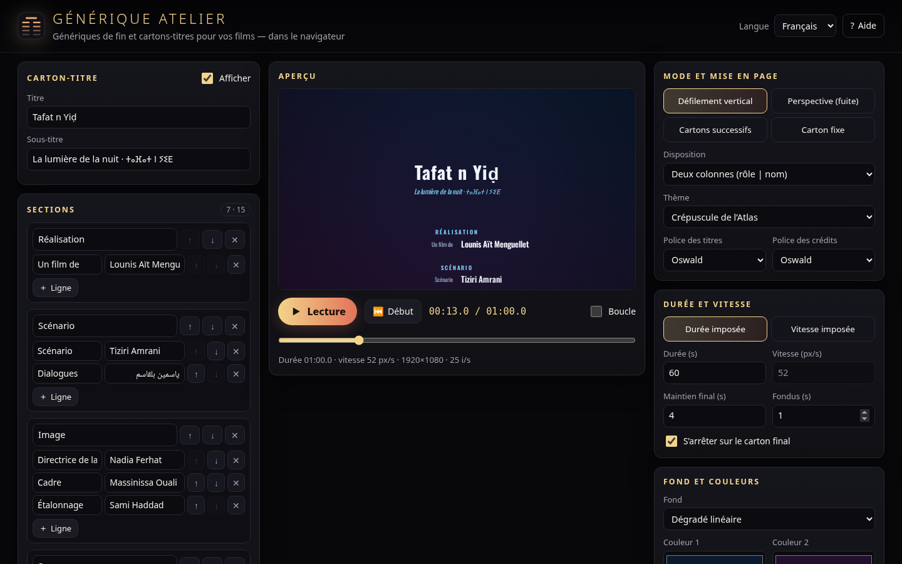
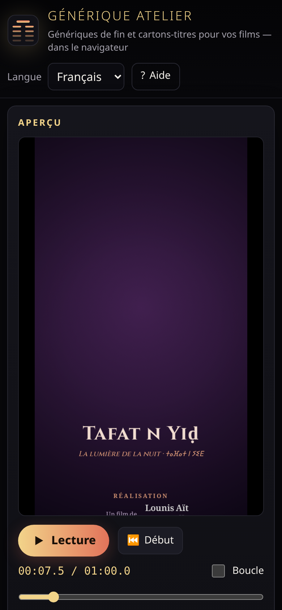
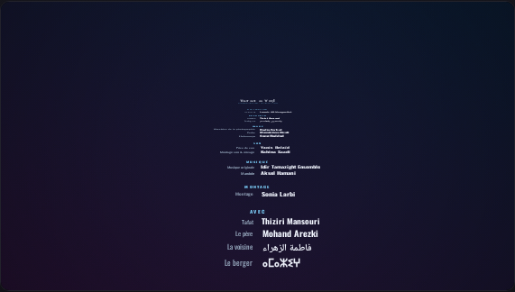
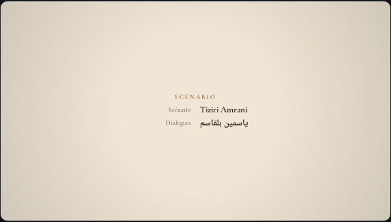

# Générique Atelier 🎬📜

**Générateur gratuit de génériques de fin et de cartons-titres pour vidéastes, 100 % dans le navigateur.**
Saisissez vos crédits (ou collez-les en texte), choisissez un mode — **défilement vertical**, **perspective qui fuit vers l’horizon**, **cartons successifs en fondu** ou **carton fixe** —, un thème et un format (16:9, scope 2.39:1, 9:16, 1:1, 4K), puis exportez une **vidéo WebM**, une **image PNG** ou le **projet JSON**. Aucune installation, aucun compte, aucun traceur : tout est calculé localement. Interface en **français**, **anglais** et **taqbaylit** ; noms en **arabe** rendus de droite à gauche et **tifinagh** pris en charge.

🔗 **Démo en ligne : https://salimadour31-boop.github.io/generique-atelier/**

| Ordinateur | Mobile |
|---|---|
|  |  |

| Mode perspective | Cartons successifs (thème « Sable clair ») |
|---|---|
|  |  |

## Fonctionnalités

- **Éditeur de crédits** : carton-titre (titre + sous-titre), sections (Réalisation, Image, Son, Musique, Avec…) composées de lignes *rôle / nom* ; ajout, suppression et réorganisation (↑ ↓) des sections et des lignes ; carton final (« Fin », remerciements, **logo** chargé depuis votre ordinateur, jamais envoyé).
- **Collage de texte** : une ligne par crédit au format `Rôle : Nom` (accepte aussi tabulation, `—` et `：`) ; une ligne vide ou une ligne `# Titre` démarre une nouvelle section ; une ligne seule en tête de bloc devient le titre de la section ; les lignes sans séparateur deviennent des noms seuls. Remplacer ou ajouter à la suite, et recharger le texte actuel.
- **4 modes** :
  - **Défilement vertical** classique, avec option d’**arrêt sur le carton final** (maintien réglable puis fondu) ;
  - **Perspective (fuite)** : le texte glisse sur un plan incliné et s’éloigne vers l’horizon (interprétation originale, avec raccourcissement réel des lettres) ;
  - **Cartons successifs** avec fondus enchaînés — les sections trop longues sont découpées automatiquement (titre de section répété) ;
  - **Carton fixe** (titre seul) avec fondu d’entrée et de sortie.
- **3 dispositions** : deux colonnes centrées (rôle aligné à droite | nom aligné à gauche — colonnes inversées si le rôle est en arabe), une colonne empilée, noms seuls.
- **Typographie** : polices système et polices libres **OFL** chargées depuis Google Fonts — Cormorant Garamond, Cinzel, Oswald, Josefin Sans, **Noto Naskh Arabic**, **Noto Kufi Arabic**, **Noto Sans Tifinagh** ; repli automatique arabe + tifinagh dans toutes les piles de polices ; direction RTL par chaîne (les noms arabes sont façonnés et ordonnés correctement), pas d’interlettrage sur l’arabe ; tailles, interligne, espace entre sections, gouttière, largeur, capitales.
- **Fond et couleurs** : uni, dégradé linéaire (angle), dégradé radial ou **transparent** (aperçu sur damier, PNG avec vraie couche alpha) ; couleurs des titres, sections, rôles et noms ; ombre portée ; **grain argentique** animé et **vignettage**.
- **6 thèmes originaux** : Nuit noire, Argentique, Crépuscule de l’Atlas, Sable clair, Aurore, Incrustation (fond transparent).
- **Formats** : 16:9 1920×1080, **2.39:1 scope** 1920×804, 9:16 1080×1920, 1:1 1080×1080, **4K UHD** 3840×2160 ; 24 / 25 / 30 / 60 i/s. Les tailles sont exprimées pour une image de 1080 px de côté court et s’adaptent à chaque format.
- **Durée ou vitesse** : imposez la durée (la vitesse en px/s est calculée) ou la vitesse (la durée est calculée) ; maintien final, durée des fondus.
- **Aperçu en direct** sur canvas : lecture / pause, retour au début, barre de position, boucle, minutage.
- **Exports** : **vidéo WebM** (`canvas.captureStream` + `MediaRecorder`, en temps réel, barre de progression, annulation, débit réglable), **PNG de l’image actuelle** à la résolution de sortie, **PNG du générique complet** (une seule grande image), **projet JSON** (enregistrer / ouvrir, validé), **copier en texte**.
- **Sauvegarde automatique** du projet et de la langue (localStorage), exemple fictif rechargeable.
- **Accessible et responsive** : champs étiquetés, focus visibles, annonces pour lecteurs d’écran, raccourcis clavier ; mise en page ordinateur, tablette et mobile (aperçu en premier sur téléphone).

## Utilisation

1. Ouvrez la [démo](https://salimadour31-boop.github.io/generique-atelier/) (ou `index.html` via un petit serveur local).
2. Remplacez l’exemple : modifiez le carton-titre, les sections et le carton final, ou collez votre liste dans **Coller du texte** :
   ```
   # Image
   Directrice de la photographie : Nadia Ferhat
   Cadre : Massinissa Ouali

   # Avec
   Tafat : Thiziri Mansouri
   La voisine : فاطمة الزهراء
   ```
3. Choisissez le **mode**, la **disposition**, le **thème**, les polices et le **format** ; réglez la durée ou la vitesse.
4. Vérifiez avec **Lecture** et la barre de position, puis **Exportez la vidéo (WebM)** — gardez l’onglet visible pendant l’enregistrement, qui dure le temps du générique. Importez le fichier dans DaVinci Resolve, Premiere, Kdenlive, Shotcut, CapCut…
5. Pensez à **Enregistrer le projet (JSON)** pour le retravailler plus tard.

### Raccourcis clavier

| Touche | Action |
|---|---|
| `Espace` | Lecture / pause |
| `Home` | Revenir au début |
| `←` / `→` | Reculer / avancer d’une seconde |
| `?` | Aide |
| `Échap` | Fermer l’aide |

## Structure du code

```
index.html      page unique
style.css       thème sombre « salle de projection » (or et corail)
js/core.js      logique pure : schéma et validation du projet, formats, thèmes, polices, analyseur de texte,
                détection RTL, moteur de mise en page (testable avec n’importe quelle fonction de mesure),
                calculs de durée / vitesse (défilement, perspective, cartons, fondus), noms de fichiers
js/render.js    rendu canvas : mesure des textes, fond, grain, vignettage, 4 modes, planche complète
js/i18n.js      textes FR / EN / Taqbaylit
js/app.js       interface, éditeur, liaisons des réglages, lecture, exports, sauvegarde, raccourcis
tests/          tests unitaires (Node) et de bout en bout (Playwright)
```

### Lancer en local et tester

```bash
python3 -m http.server 8793          # puis ouvrir http://localhost:8793/
node tests/unit.js                   # tests unitaires, sans dépendance
npm i playwright && npx playwright install chromium   # (en dehors du dépôt)
GA_URL=http://localhost:8793/ node tests/e2e.js       # SHOTS=1 pour régénérer les captures
```

Les tests unitaires (53) couvrent l’analyseur de texte (séparateurs, sections, BOM, CRLF), l’aller-retour texte, la validation, la détection RTL, le retour à la ligne, les dispositions (alignements, inversion arabe), le découpage en cartons, les calculs durée ⇄ vitesse et la projection en perspective. Les tests de bout en bout (63) vérifient à 1440×900 et 390×844 : chargement sans erreur console, changement et mémorisation de la langue, édition / ajout / déplacement / suppression de crédits, collage de texte, lecture, pause, position, raccourcis, les 4 modes et 3 dispositions, thèmes et couleurs, PNG (16:9, 2.39:1, 9:16), planche complète, transparence alpha, JSON (enregistrer / ouvrir / rejet d’un fichier invalide), copie en texte, logo, **export WebM** (en-tête EBML, décodage 1920×1080), sauvegarde automatique, absence de débordement sur mobile.

### Limites connues

- L’export vidéo se fait **en temps réel** (un générique de 2 min prend 2 min) et l’onglet doit rester visible ; en 4K à 60 i/s, un ordinateur modeste peut perdre des images — préférez 1080p ou 25 i/s.
- Le WebM est produit par le navigateur (VP9 / VP8) : Chrome, Edge et Firefox le gèrent ; Safari peut ne pas proposer `MediaRecorder` en WebM. La transparence n’est garantie que dans les exports PNG.
- Les polices Google sont téléchargées depuis fonts.googleapis.com au premier usage (aucune donnée personnelle envoyée par l’outil) ; hors ligne, les polices système prennent le relais.
- La traduction taqbaylit est faite au mieux ; les corrections sont les bienvenues (issue ou pull request).

---

## English

**Générique Atelier** is a free, open-source **end-credits and title-card generator** for video makers that runs entirely in the browser — no install, no account, no tracking.

**Demo:** https://salimadour31-boop.github.io/generique-atelier/

**Features:** credits editor (title card, sections of role/name rows with add/remove/reorder, closing card with “The End”, thanks and a local logo image); plain-text bulk paste (`Role : Name` lines, blank line or `# Title` starts a section); four modes — **vertical roll** (optionally stopping on the closing card), **perspective crawl** (an original take with true foreshortening), **sequential cards** with cross-fades (long sections split automatically) and a **still title card**; three layouts (two-column centred, single stacked column, names only); system fonts and free OFL Google Fonts including **Noto Naskh/Kufi Arabic** and **Noto Sans Tifinagh**, correct **right-to-left** rendering of Arabic names; solid / linear / radial / **transparent** backgrounds, text colours, sizes, spacing, film grain, vignette, 6 original themes; formats 16:9 1080p, **2.39:1 scope**, 9:16, 1:1, **4K UHD** at 24/25/30/60 fps; fixed duration or fixed speed (px/s) with the other value computed; live canvas preview with play/pause/scrub/loop; exports: **WebM video** (canvas.captureStream + MediaRecorder, real time), **PNG of the current frame**, **PNG of the full credits sheet**, **JSON project** save/load and **copy as text**; autosave; UI in French, English and Taqbaylit; accessible, responsive, keyboard shortcuts (Space, Home, ←/→, ?).

**Usage:** open the demo, replace the example credits (or paste them as text), pick a mode, layout, theme and format, preview, then click *Export video (WebM)* and keep the tab visible while it records.

**Tests:** `node tests/unit.js`, then serve the folder and run `GA_URL=http://localhost:8793/ node tests/e2e.js` (Playwright + Chromium).

## Licence / License

[MIT](LICENSE) © 2026 Amirouche Amwanes (salimadour31-boop)

Polices / fonts: SIL Open Font License, servies par Google Fonts. Aucun code, logo ni visuel tiers n’est inclus.
